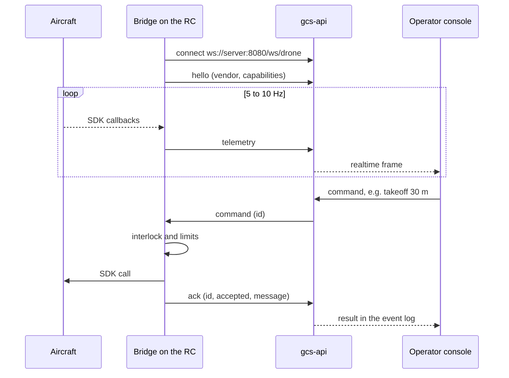

<div align="center">


# PASUPASASTRA Bridge

**The field side of PASUPASASTRA: apps on the drones' remote controllers that connect each aircraft
to the ground control station over one protocol. One submodule per drone model, so a new drone is a
new folder.**

[](https://github.com/DarmawanWeb/PasupasastraBridge/actions/workflows/ci.yml)
[](https://github.com/DarmawanWeb/pasupasastra-bridge-dji-matrice-4t/actions/workflows/ci.yml)
[](https://github.com/DarmawanWeb/pasupasastra-bridge-autel-evo2-v3/actions/workflows/ci.yml)
<br>


[](LICENSE)

[Bridges](#bridges) · [How it works](#how-it-works) · [Get the code](#get-the-code) ·
[Add a drone](#add-a-drone) · [Protocol](PROTOCOL.md)

</div>

---

Part of [PASUPASASTRA](https://github.com/DarmawanWeb/Pasupasastra), where this repository is
mounted as `bridges/`. Each bridge runs on the controller that flies the aircraft, talks to it
through the vendor's SDK, and talks to the [GCS backend](https://github.com/DarmawanWeb/pasupasastra-gcs-be)
through the same [protocol](PROTOCOL.md): telemetry, commands with acknowledgements, waypoint
missions and events over one WebSocket, video over RTMP to MediaMTX.

## Bridges

| Folder | Aircraft | Runs on | SDK | Telemetry | Commands | Missions | Video |
|---|---|---|---|---|---|---|---|
| [`dji-matrice-4t/`](https://github.com/DarmawanWeb/pasupasastra-bridge-dji-matrice-4t) | DJI Matrice 4T | DJI RC Plus 2 Enterprise | DJI MSDK v5.17 | 10 Hz | takeoff, land, RTH, hold, go to (no separate arm) | KMZ (WPML) | RTMP from the bridge; RGB, thermal, split |
| [`autel-evo2-v3/`](https://github.com/DarmawanWeb/pasupasastra-bridge-autel-evo2-v3) | Autel EVO II V3 | Autel Smart Controller V3 | Autel SDK v1.5 | 1–20 Hz (5) | arm, disarm, takeoff, land, RTH, hold, go to | native waypoint mission | RTMP from Autel's app |

Every bridge ships with an interlock, **Izinkan kendali dari GCS**, that is off by default: without
it a bridge only sends telemetry. With it, the bridge re-checks the GCS's safety limits (altitude
5–120 m, at most 1000 m from the aircraft, 10 m/s, 99 waypoints) before any SDK call, and stopping
the bridge never affects the aircraft.

Next on the roadmap: MAVLink for PX4 and ArduPilot, telemetry from LITO X1 and SIYI, and a real
payload drop through the DJI Payload SDK.

## How it works



## Get the code

```bash
git clone --recursive https://github.com/DarmawanWeb/PasupasastraBridge.git
# or everything, with the server and the console:
git clone --recursive https://github.com/DarmawanWeb/Pasupasastra.git    # this repository is bridges/
```

Each bridge builds on its own (Flutter, Android Studio, the vendor's app key and SDK); see its
README. App keys and vendor SDK binaries are never committed.

## Add a drone

1. Create `pasupasastra-bridge-<vendor>-<model>` in DarmawanWeb, named the way people call the
   aircraft: `dji-mavic-3t`, `autel-evo-max-4t`, `siyi-…`.
2. Start from the closest bridge (Flutter UI, native SDK in a foreground service), or write any
   program that speaks the protocol, such as a MAVLink bridge on a companion computer.
3. Speak the [protocol](PROTOCOL.md): connect to `/ws/drone`, send `hello` first, telemetry in the
   generic GCS format at 5–10 Hz, reconnect with backoff, answer every command with an `ack` (10 s,
   missions 30 s) whose message is in Bahasa Indonesia, and send `event`s the operator must see.
4. Keep it safe: the interlock is off by default, the limits are checked again against the latest
   GPS fix, and a stopped bridge leaves the aircraft to the pilot.
5. Keep secrets out of git: app keys in `android/local.properties` or the environment, vendor SDK
   binaries ignored.
6. Copy the README layout, `LICENSE`, `docs/logo.svg`, `.github/workflows/ci.yml` and
   `lefthook.yml` from an existing bridge.
7. Add it here and point the system at it:
   ```bash
   git submodule add ../pasupasastra-bridge-<vendor>-<model>.git <vendor>-<model>
   git commit -m "feat: add <vendor> <model> bridge"
   # then, in Pasupasastra: commit the new bridges/ pointer
   ```
   and add its row to the table above. The `ci` workflow checks that every bridge has a README, a
   LICENSE and its own CI.

The server needs no change for a bridge that uses the generic format; a vendor-specific format or
mode mapping goes in `gcs_api/fleet/normalize.py` of the backend.

Proprietary: © 2026 I Wayan Agus Darmawan (DarmawanWeb), all rights reserved. See [LICENSE](LICENSE).
The vendor SDKs are subject to their owners' terms.
